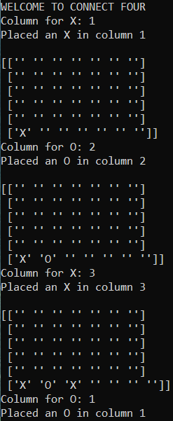

# PyGames

Small Python game experiments: a terminal Connect Four and a Pygame Flappy-style prototype.

## Games

### Connect Four (`ConnectFour.py`)

- Terminal / NumPy board (6×7)
- Two-player alternate turns placing `X` and `O` by column number (1–7)
- Drops pieces into the lowest empty cell in the chosen column

```bash
python ConnectFour.py
```

Requires: `numpy`

### Flappy Frogger (`FlappyFrogger.py`)

- Pygame window (360×480, 30 FPS)
- Green player square; hold **Up** to rise, otherwise gravity pulls down
- Three looping colored obstacles scroll left at different speeds

```bash
python FlappyFrogger.py
```

Requires: `pygame`

## Screenshot / demo



## Notes

- These are learning prototypes: Connect Four has no win-detection loop exit, and Flappy Frogger has no collision/scoring yet.
- No `requirements.txt` is checked in; install `numpy` and `pygame` as needed.
